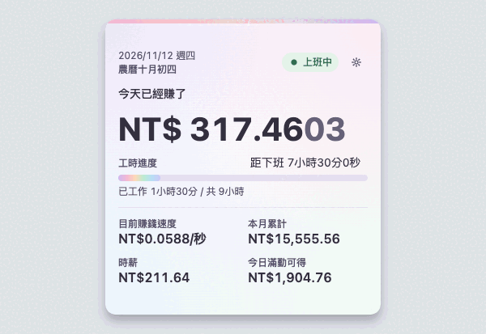
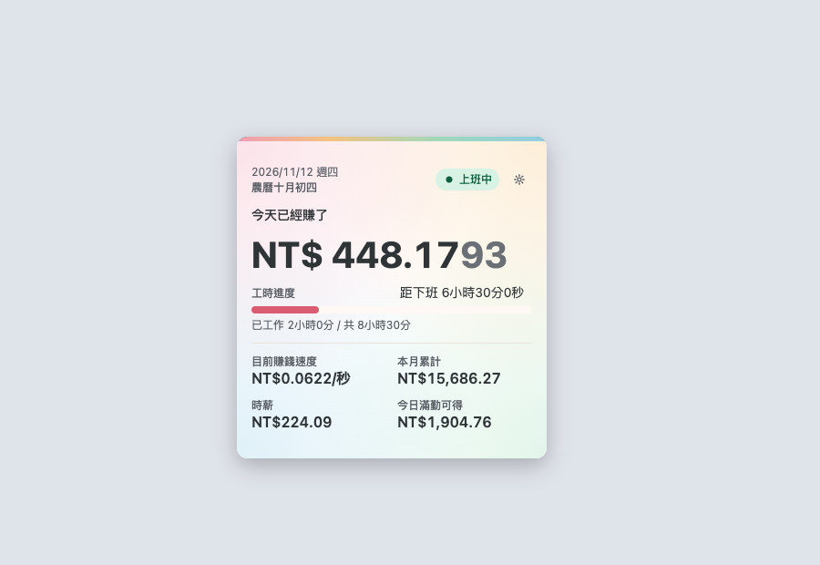
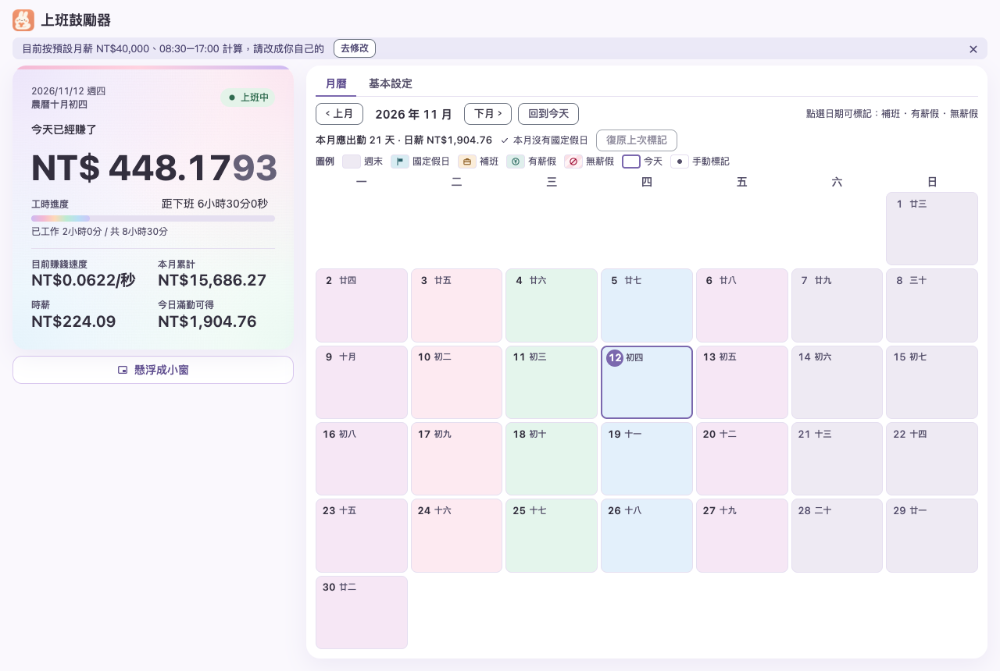

# 上班鼓勵器

把上班時間換算成「今天已經賺了多少」，讓你一眼看見工作進度；同時提供可標記工作、休假與調休的月曆。單一 HTML 檔、無需帳號、資料只存在你的瀏覽器裡。

> 線上版：<https://kevin-kuantso.github.io/work-motivator/>



> 小窗動圖從 2026-11-12 10:30 播放到 18:05（臺北時間），以預設月薪 NT$40,000、上下班 09:00–18:00 計算，下班後顯示收工訊息。小窗以模擬方式呈現在空白背景上，並非作業系統的原生視窗；實際數字依你的設定與當下時間而定。

## 功能

- **即時進度與估算收入**：依月薪、上下班時間與午休計算今日已賺、時薪、本月累計與今日滿勤可得。
- **月曆標記**：可標記補班、有薪假、無薪假；內建台灣 2026、2027 年行政機關辦公日曆。
- **地區切換**：預設臺灣（繁體中文）；可切換為中國大陸（簡體中文、人民幣、大陸法定假日與調休）。兩地的薪資與手動標記各自保存、不自動換算幣別。
- **懸浮小窗**：把狀態卡懸浮成小窗，依賴原頁面保持開啟。
- **個人化**：六種主題色加柔光彩虹、可自訂多句鼓勵語、字級 XS–XL、可選擇顯示的欄位、農曆顯示。
- **備份與還原**：匯出／匯入 JSON 備份。



> 示範時間為 2026-11-12 10:30（臺北時間，上班中），數字依預設月薪 NT$40,000 計算。大視窗僅用於設定，見下方設定頁截圖。




> 月曆以 2026 年 11 月為例：點選日期開啟選單，即可調整補班、有薪假或無薪假，並即時看到當月應出勤天數與日薪的變化。

## 快速開始

**使用線上版**：直接開啟[線上版網頁](https://kevin-kuantso.github.io/work-motivator)即可。

**離線使用**：

```bash
git clone https://github.com/kevin-kuantso/work-motivator.git
cd work-motivator
npm install
npm run build
```

用瀏覽器開啟 `dist/work-motivator.html`。這個檔案已內嵌所有 CSS、JavaScript 與標題圖示，可離線使用。

**macOS / Windows 桌面版**：桌面殼與 HTML 版共用同一套前端來源，提供不依賴瀏覽器頁面的原生懸浮小窗；主畫面的左側預覽會同步小窗尺寸。詳細建置與備份行為見 [electron/README.md](electron/README.md)。

```bash
npm --prefix electron install
npm run desktop:start
```

## 資料與隱私

- 設定、標記與鼓勵語只儲存在這個瀏覽器的本機儲存空間，不會上傳。
- 中國大陸的假日更新會對外部網址發出一般的 GET 請求（不帶任何設定資料），因此你的 IP 位址與瀏覽器資訊仍會被該服務看到。臺灣版不連網。詳見「假日與薪資說明」。
- **清除瀏覽器網站資料會遺失設定**。請先在「基本設定」中匯出備份。
- 備份檔包含月薪、上下班時間、主題色與月曆標記；**不包含**假日資料與自訂資料網址。

## 假日與薪資說明

**臺灣**

- 內建 2026、2027 年行政院人事行政總處政府行政機關辦公日曆（[政府資料開放平臺資料集 14718](https://data.gov.tw/dataset/14718)）。
- 本版不連網更新。需要新年度時，請自行下載該年度完整 UTF-8 CSV，再用「匯入假日表檔案」手動匯入；匯入只讀本機檔案。
- 辦公日曆不代表所有勞工的法定假期，企業可能不同。薪資僅為估算。
- 資料授權：依[政府資料開放授權條款第 1 版](https://data.gov.tw/license)提供；商業再散布仍須法務確認。

**中國大陸**

- 內建法定節假日與調休資料。更新來源是 [NateScarlet/holiday-cn](https://github.com/NateScarlet/holiday-cn) 的年度 JSON（第三方社群維護，GitHub 顯示授權為 MIT），依序嘗試 `cdn.jsdelivr.net`、`fastly.jsdelivr.net`、`raw.githubusercontent.com`。來源若回傳空檔或格式不合格，會改試下一個。
- 若在進階設定填入自訂資料網址，會排在上述來源之前嘗試。
- **自動檢查**：地區為中國大陸時，啟動頁面或切換到中國大陸，若距離上次檢查已超過 24 小時，且當年（11–12 月時還包括次年）沒有資料，程式會自動檢查一次。也可以隨時按「檢查更新」手動檢查。
- 以上連線都需要網路，且依賴外部服務的可用性。

**預設月薪**

- 臺灣預設 NT$40,000，依主計總處 2025 年工業及服務業本國籍全時受僱員工每月經常性薪資中位數 39,890 元向上取整至千元推算（[主計總處](https://www.dgbas.gov.tw/News_Content.aspx?n=3602&s=235863)）。這不是全體員工或總薪資的中位數，請改成你的實際月薪。
- 中國大陸預設 ¥5,000，取第三方估計 2024 年全國雇員月薪中位數區間的下限，**非官方統計**。

**「開始計薪」顯示 0 是預期行為**：未到上班時間（預設 09:00）前，金額固定為 0.00，標籤會顯示幾點開始計薪。

## 開發

```bash
npm install          # 安裝相依套件
npm test             # 單元測試（node --test）
npm run build        # 產生 dist/work-motivator.html
npm run e2e          # 瀏覽器測試（需要本機 Chrome，見下方）
npm run e2e:real     # 操作本機 Chrome 與原生子母畫面測試，執行期間請勿操作鍵盤或滑鼠
```

- E2E 測試以 `playwright-core` 搭配 `channel: 'chrome'` 啟動本機 Chrome。
- 建置由 `build.mjs`（esbuild）完成，會移除 HTML 註解並內嵌 CSS／JS。

### 專案結構

```
src/
  main.js               入口
  settings.js           設定、地區（REGIONS / DEFAULT_REGION）與預設薪資
  calc.js               工時與金額計算
  holiday-*.js          假日資料與來源（臺灣、中國大陸）
  strings.zh-TW.js      繁體中文文案（臺灣預設）
  strings.zh-CN.js      簡體中文文案（中國大陸）
  ui/                   畫面元件（月曆、卡片、設定頁、小窗等）
  index.template.html   建置樣板
  style.css             樣式與設計 token
build.mjs               建置腳本
test/                   單元測試
e2e/                    瀏覽器測試
docs/images/            README 截圖與動圖
```

### 部署

`.github/workflows/pages.yml` 會在推送到 `main` 時執行測試、建置，並部署到 GitHub Pages。首次部署需要在 repo 設定中啟用 Pages（來源：GitHub Actions），或以 `gh api repos/<owner>/<repo>/pages -f build_type=workflow` 啟用。

## 瀏覽器支援

目前只在本機 Chrome 上執行過測試（E2E 與懸浮小窗）。其他瀏覽器尚未逐一驗證；懸浮小窗依賴瀏覽器支援的子母畫面功能。

## 授權

本專案的程式碼以 [MIT License](LICENSE) 授權。

下列內容**不在** MIT 授權範圍內，使用前請另行確認：

- **假日資料**：臺灣內建資料來自政府資料開放平臺，依[政府資料開放授權條款第 1 版](https://data.gov.tw/license)提供，商業再散布仍須法務確認。
- **中國大陸假日資料**：內建的 2026、2027 年資料，程式註解標示來源為國務院公告（國辦發明電〔2025〕7 號、〔2026〕10 號，見 `src/holidays-cn.js`）。2026-11-12 比對，這份資料與 holiday-cn 的年度 JSON 逐日一致（2026：假日 33 天、補班 6 天；2027：假日 29 天、補班 5 天）。內建日期已與兩份公告（[2026](https://www.gov.cn/zhengce/zhengceku/202511/content_7047091.htm)、[2027](https://www.gov.cn/zhengce/content/202611/content_7085101.htm)）逐日核對一致。中國政府網的[網站聲明](https://www.gov.cn/home/2014-02/23/content_5046258.htm)規定：不得商業性原版原式轉載、網站內容版權歸該網站所有、其他單位提供的資訊轉載須取得授權。本專案內建的是依公告整理的日期清單，並非公告原文轉載，但是否構成再散布，請法務確認。線上更新抓取的 NateScarlet/holiday-cn 依其 GitHub 頁面為 MIT 授權。
- **薪資估算值**：預設月薪與第三方估計值的依據見上方「假日與薪資說明」，不代表官方統計。

## 致謝

標題旁的兔子圖示（`src/logo.png`）由作者以 AI 工具設計，已內嵌於建置後的單一 HTML 檔。
